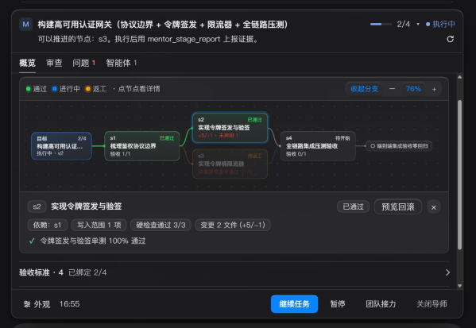
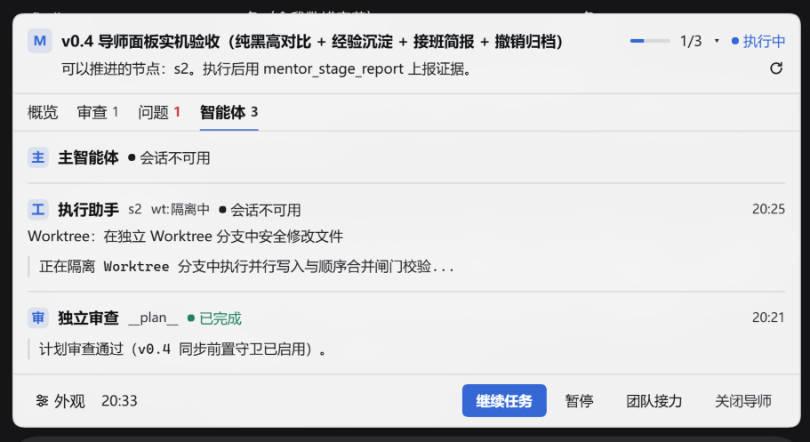
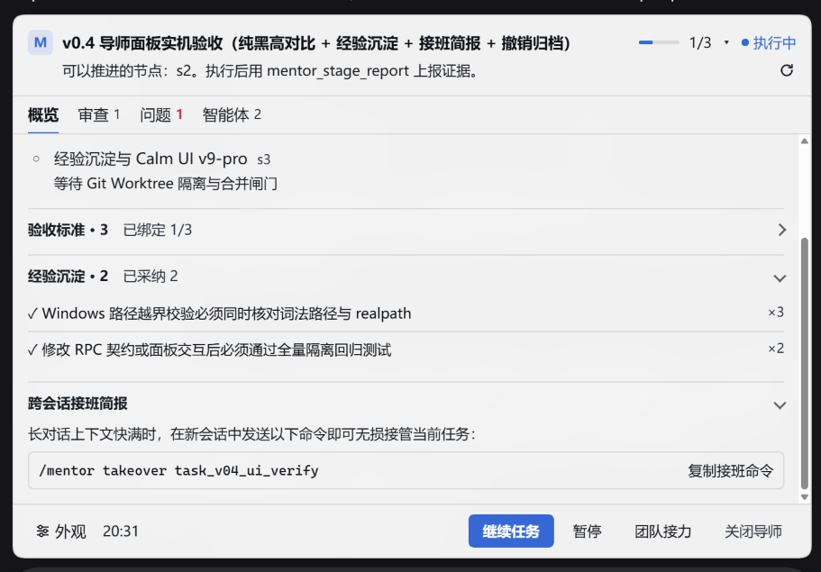
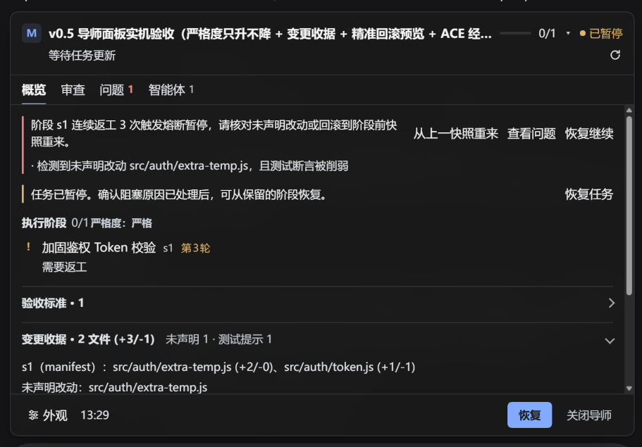

# dsh-mentor

> **Clean-room, zero-dependency task supervision & independent verification plugin for DeepSeek Harness.**
>
> 面向 DeepSeek Harness 的洁净室、零外部依赖任务督导与独立审查插件 —— 为复杂 AI 编程任务提供 DAG 计划审查、前置硬检查、真实 Diff 审计、变异测试防空洞、独立只读审查、卡死熔断与苹果风交互式思维导图面板。



---

## 界面演示（真机实拍）

### 1. 苹果风交互式思维导图 & 节点详情抽屉（深色模式）
首屏即呈现 **Apple Freeform / MindNode** 点阵画布与有机三次贝塞尔曲线，自动缩放适配视口（零右边缘裁切）；点选任意阶段节点自动聚焦上下游链路并压暗无关分支，底部展开 **Node Inspector** 显示依赖、写入范围、硬检查、变更统计、验收勾选与一键预览回滚。


### 2. 并行执行助手（Git Worktree 隔离）与独立审查员（浅色高对比模式）
明暗双主题均采用高对比度清晰排版；智能体视图实时展示主智能体、独立 Git Worktree 物理隔离的执行助手与只读独立审查员状态。



### 3. 项目经验沉淀（ACE）与跨会话无损接班
自动提炼高价值审查教训、人工采纳后按路径作用域自动注入，并提供一键复制 `/mentor takeover <taskId>` 跨会话无损接管命令。



### 4. 返工熔断保护、真实 Diff 变更收据与快照回滚
连续返工达到上限自动暂停并输出升级简报；真实比对工作区 Diff，清晰标出未声明文件与测试断言削弱提示，支持从阶段前快照一键预览并安全回滚。



---

## 核心特性（v1.0.0）

| 模块 | 能力说明 |
|---|---|
| **DAG 计划与独立审查闭环** | `建任务 → 提交 DAG 计划 → 独立计划审查 → 阶段执行/并行派发 → 前置硬检查 → 独立阶段审查 → 整体验收`。审查会话强制只读并挂接同步前置工具守卫（拦截写文件/Shell/越界路径/超预算调用）。 |
| **苹果风交互式思维导图面板** | `概览` 首屏即呈现 **Apple Freeform / MindNode** 风格点阵画布思维导图：支持 1 阶段与多阶段菱形分支、三次贝塞尔有机曲线、**Auto-Fit 自动适应缩放**、点击节点聚焦上下游链路并压暗无关分支、底部 **Node Inspector** 详情抽屉与 **`导图 \| 列表`** macOS 分段切换。 |
| **防空洞验证与真实 Diff 审计** | 阶段上报前自动执行前置确定性硬检查（含 Windows 无 `pwsh` 时透明回退 `powershell` 并显式提示）、真实 Git/文件快照 Diff 审计（标出未声明改动与越界写入）、反测试篡改扫描（`TEST_SKIP` / 弱断言检测）、**Diff-scoped 变异测试**（`/mentor mutate`）与 **Fail-to-Pass（`f2p`）** 校验。 |
| **风险分级与安全护栏** | `express / standard / strict` 三档动态严格度（涉及敏感路径或多次返工自动升档，绝不静默降级）；行为级**循环卡死检测**（`StuckDetector`：重复报错 / AB 震荡 / 搜索空转先纠偏后拦截）；**模糊需求前置澄清门**（`/mentor clarify`）；**外部 MCP 工具 Schema 漂移与描述投毒检测**（防 Rug-Pull）。 |
| **物理隔离与可逆恢复** | 支持可选 **Git Worktree** 并行物理隔离（只读 `git apply --check` 顺序合并闸门）；阶段级文件快照与**两步确认安全回滚**（带外部改动冲突检测）；`Clear` 归档支持 10 秒面板快捷撤销与 `/mentor restore` 随时恢复；支持跨会话无损接班（`/mentor handoff` & `/mentor takeover`）。 |
| **工程化交付与自进化经验库** | 一键导出可贴 PR 的 **Verification Receipt**（含显式 `UNVERIFIED` 边界段）、可验证 SHA-256 **任务护照**（`Task Passport`）、标准化 **ATIF v1.6** 执行轨迹与 **项目健康评分**（`/mentor health`）；基于 ACE 模式的项目级**复盘经验沉淀**（候选先人工采纳、glob 路径匹配注入、正负反馈自动降权）。 |
| **严格工程契约** | **0 运行时第三方依赖**（纯 Node.js ≥ 22 内置模块 + 宿主 React）；严格收敛 **27 个全局 MCP 工具**；完整洁净室边界审计与 MIT 开源许可（见 [CLEANROOM.md](CLEANROOM.md)）。 |

---

## 快速安装与启用（DeepSeek Harness）

1. 克隆本仓库到本地任意目录（例如 `<path>/dsh-mentor`）：

```bash
git clone https://github.com/hoducthien36-lang/dsh-mentor.git
```

2. 在你的 DeepSeek Harness profile 中链接并启用 `dsh-mentor`（参考 `cordis.patch.yml`）：

```yaml
- insert:
    - id: mentor
      name: "dsh-mentor"
      config:
        # 显式指定持久化目录；留空则以纯内存模式运行，绝不误写磁盘
        stateDir: "./data"
```

3. 重启或重载 DeepSeek Harness 即可在顶部看到「导师模式」与「Clear」按钮，在输入框上方看到苹果风任务导图面板。

---

## 常用 Slash 命令

| 命令 | 说明 |
|---|---|
| `/mentor new <目标>` | 创建受督导任务并进入规划阶段 |
| `/mentor status` | 查看当前任务进度、阶段与下一步指引 |
| `/mentor approve` / `pause` / `resume` | 批准计划 / 暂停 / 恢复任务 |
| `/mentor clear` / `restore [taskId]` | 归档当前任务（10 秒内面板一键撤销）/ 随时恢复归档任务 |
| `/mentor handoff` / `takeover <taskId>` | 生成跨会话接班简报（≤4KB）/ 在新会话原子接管 |
| `/mentor rigor [express\|standard\|strict]` | 查看或调整审查严格度（支持升档/留痕） |
| `/mentor rollback <stageId> [--confirm]` | 预览或确认回滚指定阶段的文件快照 |
| `/mentor clarify [questionId] [answer]` | 查看或回答前置模糊边界澄清问题 |
| `/mentor mutate [stageId]` | 对阶段改动执行 Diff-scoped 变异测试 |
| `/mentor receipt` / `passport` / `trace` / `health` | 导出 PR 验证收据 / SHA-256 任务护照 / ATIF v1.6 轨迹 / 任务健康评分 |

---

## 核心配置项

| 配置项 | 默认值 | 说明 |
|---|---|---|
| `stateDir` | `""`（纯内存） | 持久化目录。留空时不落盘；配置后按主会话分目录存储任务状态与 `<stateDir>/lessons.json` 经验库。 |
| `maxParallelNodes` | `8`（范围 `1–16`） | 最大并行执行助手数（不含主会话与独立审查会话）。 |
| `enablePrechecks` | `true` | 是否在阶段上报前执行前置确定性硬检查（Windows 无 `pwsh` 时自动透明回退 `powershell`）。 |
| `precheckTimeoutMs` | `30000` | 单条前置硬检查超时（毫秒）。 |
| `reviewerModel` / `workerModel` | `null`（继承主会话） | 支持为计划/阶段/终审或执行助手配置异构模型路由（`"provider/model"` 或 `{ byKind: { plan, stage, completion } }`）。 |
| `maxStageReworks` | `3`（`0` 关闭） | 同版计划单阶段连续返工熔断上限，触发后暂停并输出升级简报。 |
| `workerIsolation` | `"none"` | 可选 `"worktree"` 为并行写入型助手启用独立 Git Worktree 物理隔离与安全合并闸门。 |
| `enableStuckDetector` | `true` | 开启行为级循环卡死检测（首次纠偏，二次熔断交由人工）。 |
| `strictClarificationGate` | `false` | 开启后，检测到高危自相矛盾或无边界破坏性需求时在规划前阻断澄清。 |

---

## 开发与测试

要求 **Node.js ≥ 22**（零外部依赖，无需 `npm install`）：

```bash
# 1. 核心文件语法检查
npm run check

# 2. 运行全量单元测试套件（673 项测试，覆盖状态机 / DAG / 审查守卫 / Diff 审计 / Worktree / 变异测试 / UI 导图）
node --test --test-force-exit test/*.test.mjs
```

---

## 仓库结构

```text
├── lib/
│   ├── index.js          # DSH 服务端插件入口（27 个工具 + Slash 命令 + RPC 端点 + 运行时调度）
│   ├── client.js         # 前端面板（苹果风交互式思维导图 + Node Inspector + 审查/问题/智能体视图）
│   └── hot-ui.js         # UI 热替换薄壳（marker: v9-pro）
├── src/
│   ├── plan/             # DAG 校验、并行度分析、计划修订与变更回显
│   ├── review/           # 独立审查协议、证据绑定、反篡改与引文校验
│   ├── runtime/          # 前置硬检查、真实 Diff 审计、变异测试、卡死检测、MCP 防投毒、护照/收据/ATIF 导出、ACE 经验库
│   ├── state/            # 任务状态机与单入口相变守卫
│   ├── tools/            # 内部工具处理器与并发派发原语
│   ├── rpc/              # 面板状态投影与控制指令分发
│   └── persist/          # 原子落盘与按主会话隔离存储
├── test/                 # 52 个自动化测试文件（673 项断言，零外部依赖）
├── docs/assets/          # 界面预览截图
├── cordis.patch.yml      # DeepSeek Harness 插件挂载声明
├── SPEC.md               # 独立编写的行为规格说明书
├── CLEANROOM.md          # 洁净室开发边界声明与相似度审计记录
└── LICENSE               # MIT License
```

---

## 许可与洁净室声明

本项目以 **[MIT License](LICENSE)** 开源发布。所有源代码依据独立编写的行为规格（[SPEC.md](SPEC.md)）从零实现，未复制任何未授权上游源码，完整边界说明见 [CLEANROOM.md](CLEANROOM.md)。
